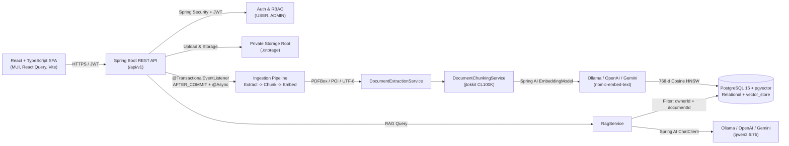

# Enterprise Document Intelligence Platform

An enterprise-grade Retrieval-Augmented Generation (RAG) platform built with **Java 21**, **Spring Boot 4**, **Spring AI 2**, **PostgreSQL + pgvector**, **Ollama** (provider-agnostic with **OpenAI** & **Google Gemini** support), and **React + TypeScript + Material UI**.

Users can securely upload PDF, DOCX, and TXT documents, extract structured text and page/section metadata, generate real vector embeddings, store and search vectors in PostgreSQL (`pgvector`) with database-level user isolation, and ask natural-language questions backed by traceable, clickable source citations.

---

## 1. Architecture Overview



---

## 2. Technology Stack

| Layer | Technology |
| --- | --- |
| **Backend** | Java 21, Spring Boot 4.0.10, Spring AI 2.0.1, Maven |
| **Persistence & Vector DB** | PostgreSQL 16, `pgvector` (HNSW + Cosine Distance), Flyway, Spring Data JPA, Spring JDBC |
| **Document Parsing** | Apache Tika (MIME/content validation), Apache PDFBox 3, Apache POI (DOCX), `jtokkit` |
| **Security** | Spring Security, Stateless HMAC-SHA256 JWT (`jjwt`), BCrypt (strength 12), Per-principal Rate Limiter |
| **AI Providers** | Ollama (`qwen2.5:7b`, `nomic-embed-text`) by default; OpenAI & Google Gemini supported via config |
| **Frontend** | React 18, TypeScript, Vite 6, Material UI 6, React Router 7, TanStack React Query, Axios |
| **Testing** | JUnit 5, Mockito, Testcontainers (`pgvector/pgvector:pg16`), MockMvc |
| **Infrastructure** | Docker, Docker Compose, Nginx |

---

## 3. Prerequisites

- **Docker & Docker Compose** (recommended for full stack + `pgvector/pgvector:pg16` + Ollama)
- For local host development without Dockerized app builds:
  - **Java 21+**
  - **Maven 3.9+**
  - **Node.js 20+** and **npm 10+**
  - **Ollama** (local or Docker)

---

## 4. Environment Configuration

Copy the environment template and set strong secrets before starting:

```bash
cp .env.example .env
```

Key environment variables:
- `POSTGRES_DB`, `POSTGRES_USER`, `POSTGRES_PASSWORD`, `POSTGRES_PORT` (defaults to `5433` on host to avoid colliding with an existing local Postgres on `5432`)
- `JWT_SECRET` (Base64 or >= 32-byte key)
- `AI_CHAT_PROVIDER` (`ollama` | `openai` | `google-genai`)
- `AI_EMBEDDING_PROVIDER` (`ollama` | `openai` | `google-genai`)
- `OLLAMA_BASE_URL`, `OLLAMA_CHAT_MODEL` (`qwen2.5:7b`), `OLLAMA_EMBEDDING_MODEL` (`nomic-embed-text`)
- `VECTOR_DIMENSIONS` (`768` for `nomic-embed-text`)
- Optional initial admin bootstrap: `ADMIN_BOOTSTRAP_EMAIL`, `ADMIN_BOOTSTRAP_PASSWORD`

---

## 5. Ollama Setup & Model Downloads

If using the bundled Ollama container in `docker-compose.yml`:

```bash
docker compose up -d ollama
docker exec -it docintel-ollama ollama pull qwen2.5:7b
docker exec -it docintel-ollama ollama pull nomic-embed-text
```

If connecting to an existing Ollama server on your host or network, set `OLLAMA_BASE_URL` in `.env` (for example `http://host.docker.internal:11434` or `http://localhost:11434`).

---

## 6. Database Setup

Flyway automatically runs `backend/src/main/resources/db/migration/V1__init_schema.sql` on startup, creating the `vector` extension and all relational tables (`roles`, `users`, `user_roles`, `documents`, `document_processing_logs`, `conversations`, `chat_messages`, `ai_audit_logs`). Spring AI's `PgVectorStore` (`initialize-schema=true`) provisions `vector_store` with 768-dimensional HNSW cosine indexing.

See [docs/DATABASE.md](docs/DATABASE.md) for the full ER diagram and relational-to-vector lifecycle design.

---

## 7. Quick Start with Docker Compose

```bash
cp .env.example .env
docker compose up -d --build
docker exec -it docintel-ollama ollama pull qwen2.5:7b
docker exec -it docintel-ollama ollama pull nomic-embed-text
```

Access:
- **Frontend UI**: `http://localhost:3000`
- **Backend API**: `http://localhost:8080/api/v1`
- **Health Check**: `http://localhost:8080/actuator/health`

---

## 8. Running Locally (Development Mode)

### Start PostgreSQL + pgvector & Ollama
```bash
docker compose up -d postgres ollama
```

### Start Backend
```bash
cd backend
mvn spring-boot:run -Dspring-boot.run.profiles=dev
```
*(Or via Java 21 container if host JDK < 21: see [docs/DEVELOPMENT_GUIDE.md](docs/DEVELOPMENT_GUIDE.md).)*

### Start Frontend
```bash
cd frontend
npm install
npm run dev
```
Vite dev server runs at `http://localhost:5173` and proxies `/api` to `http://localhost:8080`.

---

## 9. Document Ingestion & RAG Workflows

- **Document Ingestion**: `POST /api/v1/documents/upload` -> Tika + magic-byte validation -> SHA-256 deduplication -> private disk write -> PostgreSQL `UPLOADED` commit -> `@TransactionalEventListener(AFTER_COMMIT)` + `@Async` -> PDF/DOCX/TXT extraction -> token-aware chunking (800 target / 150 overlap) -> embedding -> `PgVectorStore` insert -> `COMPLETED`.
- **Grounded RAG**: Question -> ownership validation -> bounded conversation history -> database-level `ownerId` (+ optional `documentId`) filtered cosine search -> empty-hit guard (no LLM hallucination) -> prompt-injection-resistant context prompt -> Spring AI `ChatClient` -> strict chunk-derived `SourceCitationResponse` -> persisted `chat_messages` & `ai_audit_logs`.

Deep-dive documentation:
- [docs/ARCHITECTURE.md](docs/ARCHITECTURE.md)
- [docs/DATABASE.md](docs/DATABASE.md)
- [docs/RAG_PIPELINE.md](docs/RAG_PIPELINE.md)
- [docs/API_DOCUMENTATION.md](docs/API_DOCUMENTATION.md)
- [docs/DEVELOPMENT_GUIDE.md](docs/DEVELOPMENT_GUIDE.md)
- [docs/postman_collection.json](docs/postman_collection.json)

---

## 10. Security Architecture

- **Authentication**: Stateless JWT (`Bearer` tokens) + BCrypt (cost 12) + explicit JTI revocation on logout.
- **Authorization**: `ownerId` is derived strictly from `SecurityContextHolder`; client-supplied user IDs are never trusted. `PgVectorStore` queries enforce `ownerId == <currentUser>` in SQL metadata filters at retrieval time.
- **Upload Hardening**: Extension + magic byte + Apache Tika verification, path-traversal blocking, private non-web storage directory, SHA-256 deduplication per user.
- **Prompt Injection Defense**: System instructions isolate `<document_context>` as untrusted data and forbid executing instructions found inside documents.

---

## 11. Testing

```bash
cd backend
mvn test
```

All unit tests and Testcontainers (`pgvector/pgvector:pg16`) integration tests run offline without requiring an active Ollama server or external API keys.

---

## 12. Troubleshooting

- **Port 5432 conflict**: Default `POSTGRES_PORT` is `5433` on the host. Override in `.env` if needed.
- **Ollama connection refused**: Ensure Ollama is running (`docker compose ps`) and both `qwen2.5:7b` and `nomic-embed-text` are pulled.
- **Embedding dimension mismatch**: Changing embedding models requires updating `VECTOR_DIMENSIONS` and re-indexing existing documents via `POST /api/v1/documents/{id}/reprocess` (or recreating `vector_store` if dimension size changed).
- **413 Payload Too Large**: Adjust `APP_MAX_UPLOAD_SIZE` and Nginx `client_max_body_size`.

---

## 13. Future Improvements

- Replace in-process `@Async` executor with Kafka/RabbitMQ worker queues for horizontal ingestion scaling (the `DocumentReadyEvent` listener is already decoupled for this).
- Distributed Redis-backed JWT revocation and rate limiting (`Bucket4j` + Redis).
- Hybrid search (BM25 full-text + pgvector cosine reciprocal rank fusion) and OCR fallback (Tesseract) for scanned PDFs.
