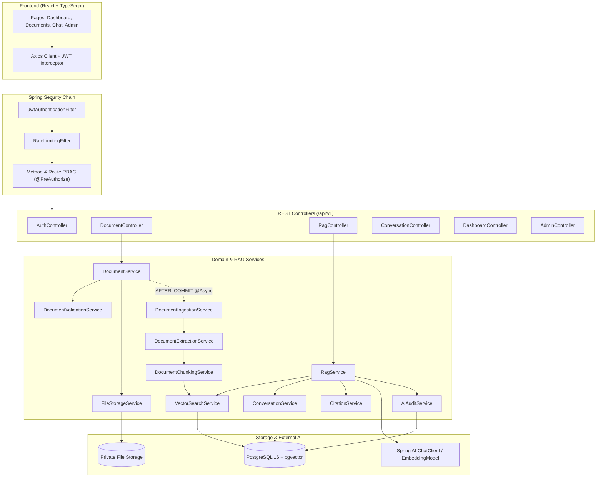

# System Architecture

## Architectural Principles

1. **Clean Layered Backend**: `controller -> service -> repository -> entity`, with immutable Java `record` DTOs at API boundaries and dedicated mapper components.
2. **Provider-Agnostic AI Integration**: Business services (`DocumentIngestionService`, `RagService`, `EmbeddingService`, `VectorSearchService`) depend exclusively on Spring AI abstractions (`ChatClient`, `EmbeddingModel`, `VectorStore`), never on concrete Ollama/OpenAI/Gemini SDK classes.
3. **Dynamic Multi-Provider Routing**: `AiProviderAutoConfigurationFilter` inspects `app.ai.chat-provider` and `app.ai.embedding-provider` at startup so Ollama, OpenAI, and Google Gemini starters can coexist on the classpath without requiring credentials for inactive providers.
4. **Decoupled Async Ingestion**: Document upload commits metadata first and publishes `DocumentReadyEvent`, consumed after commit (`TransactionPhase.AFTER_COMMIT`) by an `@Async("documentProcessingExecutor")` worker—ready to be swapped for a Kafka topic without changing `DocumentService`.

## Component Architecture



## Switching AI Providers

Update `.env` (no code changes required):

- **Ollama (Default)**:
  ```env
  AI_CHAT_PROVIDER=ollama
  AI_EMBEDDING_PROVIDER=ollama
  OLLAMA_BASE_URL=http://localhost:11434
  OLLAMA_CHAT_MODEL=qwen2.5:7b
  OLLAMA_EMBEDDING_MODEL=nomic-embed-text
  VECTOR_DIMENSIONS=768
  ```
- **OpenAI**:
  ```env
  AI_CHAT_PROVIDER=openai
  AI_EMBEDDING_PROVIDER=openai
  OPENAI_API_KEY=sk-...
  OPENAI_CHAT_MODEL=gpt-4o-mini
  OPENAI_EMBEDDING_MODEL=text-embedding-3-small
  VECTOR_DIMENSIONS=1536
  ```
- **Google Gemini**:
  ```env
  AI_CHAT_PROVIDER=google-genai
  AI_EMBEDDING_PROVIDER=google-genai
  GOOGLE_GENAI_API_KEY=...
  GEMINI_CHAT_MODEL=gemini-2.5-flash
  GEMINI_EMBEDDING_MODEL=text-embedding-004
  VECTOR_DIMENSIONS=768
  ```

> **Important**: Switching embedding providers/models to a different vector dimensionality requires recreating the `vector_store` table/index for the new dimension size and reprocessing documents.
