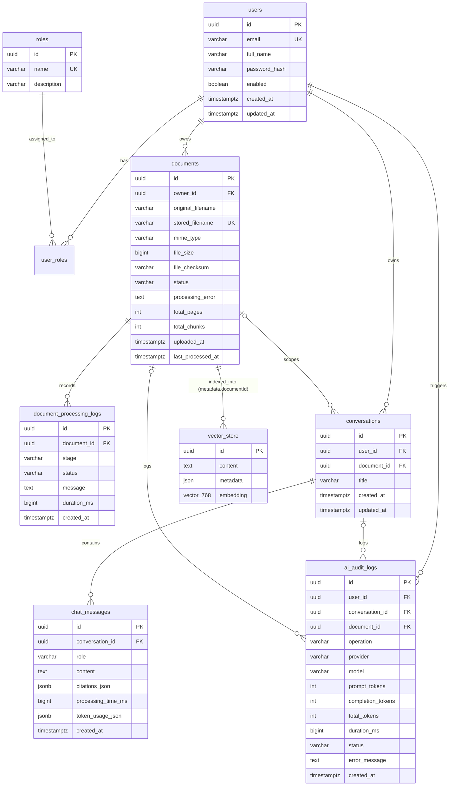

# Database Design & Vector Store Lifecycle

## Entity-Relationship Diagram

## Relationship Between Relational Metadata and `vector_store`

- **Relational Authority**: `documents` is the source of truth for ownership (`owner_id`), deduplication (`UNIQUE (owner_id, file_checksum)`), processing status (`UPLOADED`, `PROCESSING`, `COMPLETED`, `FAILED`, `DELETING`), and page/chunk counts.
- **Vector Representation**: `vector_store` (managed by Spring AI `PgVectorStore` with HNSW cosine index) stores chunk text, `768`-dimensional embeddings, and JSON metadata containing `documentId`, `ownerId`, `chunkId`, `chunkIndex`, `originalFilename`, `pageNumber` (omitted when unavailable), `sectionTitle`, and `contentHash`.
- **Consistent Lifecycle**:
  - A document transitions to `COMPLETED` **only after** `vectorStore.add(...)` succeeds.
  - On failure, partial vectors for `documentId` are cleaned up and the document is marked `FAILED`.
  - On `DELETE /api/v1/documents/{id}` or reprocessing, `VectorSearchService.deleteByDocumentId(documentId)` deletes all matching `vector_store` records via metadata filter before removing/re-indexing relational state.
- **Database-Level Authorization**: Every similarity search supplies `FilterExpressionBuilder` predicates (`ownerId == currentUserId` and optional `documentId == targetDocId`), compiled by `PgVectorStore` directly into PostgreSQL `WHERE` clauses.
