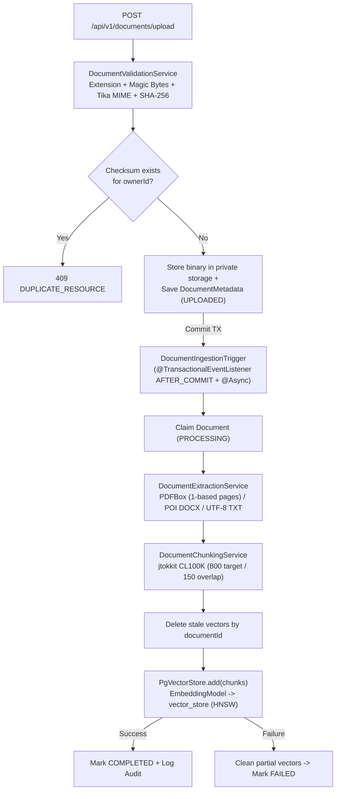
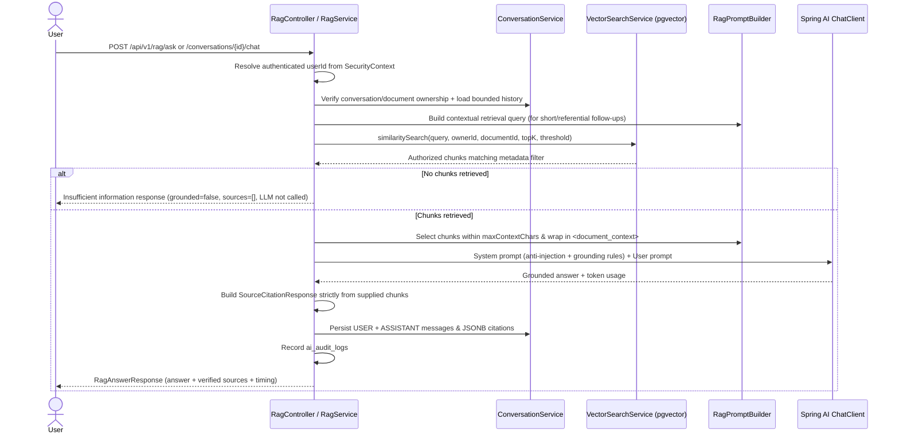

# Retrieval-Augmented Generation (RAG) & Ingestion Pipeline

## 1. Document Ingestion Workflow

## 2. Chunking Strategy

Implemented in `DocumentChunkingService` using `jtokkit` (`CL100K_BASE` token counter):

1. **Section/Page Preservation**: PDFs are extracted page-by-page (`pageNumber >= 1`, skipping blank pages while keeping true page numbers). DOCX documents preserve heading boundaries (`sectionTitle`, `pageNumber = null`). TXT files validate strict UTF-8 encoding (`pageNumber = null`).
2. **Paragraph & Sentence Integrity**: Sections are split on blank lines (`\n\s*\n`). Paragraphs exceeding `targetTokens` (default `800`) are split along sentence boundaries (`(?<=[.!?])\s+`), falling back to word boundaries only if a single sentence exceeds `targetTokens`.
3. **Configurable Overlap**: Consecutive chunks within a section carry trailing units up to `overlapTokens` (default `150`) to preserve cross-boundary semantic context.
4. **Deterministic Identifiers**: Each chunk receives `chunkId = "chunk-<index>"` and a deterministic UUID (`UUID.nameUUIDFromBytes(documentId + ":" + chunkIndex)`) plus `contentHash` (SHA-256) to prevent duplicate chunk embeddings within a document.

## 3. Retrieval & Grounded Question Answering Workflow

## 4. Prompt Injection & Hallucination Defenses

- **Authorization at Retrieval Time**: `ownerId` and optional `documentId` filters are compiled directly into the `PgVectorStore` SQL query (`FilterExpressionBuilder`), never filtered after global retrieval.
- **Zero-Context Guard**: When similarity search returns zero chunks above `similarityThreshold`, `RagService` returns an explicit insufficient-information response without invoking the LLM.
- **Untrusted Context Isolation**: Retrieved text is delimited inside `<document_context>...</document_context>` and the system prompt explicitly forbids executing instructions found inside document excerpts.
- **No Fabricated Citations**: `CitationService` derives citations strictly from the chunks actually passed into the context budget, keeping `pageNumber = null` for DOCX/TXT rather than reporting `0`.
